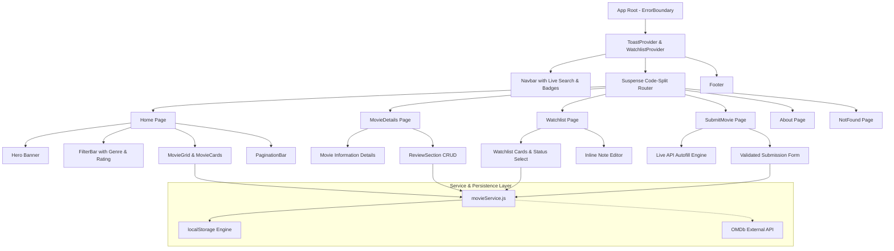

# PIMPRI CHINCHWAD COLLEGE OF ENGINEERING (PCCOE)
### Department of MCA | Academic Year 2026–2027
**Course:** Advanced Web Technologies (SYMCA, Semester III)  
**Assessment:** Formative Assessment – II (FA-2) Mini Project Report  

---

# MINI PROJECT REPORT (PHASE II)

## Title of the Project:
# CineFolio — Advanced Movie Information Portal

**Prepared by:**  
Vikrant Salunkhe (PRN: 125M1H006)  

**Guided by:**  
Prof. Dr. Avinash Chormale  

**Submitted to:**  
Department of MCA  
Pimpri Chinchwad College of Engineering  
Sector No. 26, Pradhikaran, Nigdi, Pune – 411044  

**Repository:** [https://github.com/vikrant-salunkhe/cinefolio.git](https://github.com/vikrant-salunkhe/cinefolio.git)  

---

## 1. Executive Summary & Problem Statement

Movie audiences today are overwhelmed by dispersed catalogs, clunky subscription interfaces, and fragmented review channels. Simple discovery tasks—such as looking up runtime, checking critical ratings, reading authentic audience impressions, or curating a personal watchlist—often require bloated user sign-ups or ad-heavy third-party portals.

**CineFolio** addresses this challenge by delivering a lightweight, blazing-fast, cinema-themed single-page application built on **React 18** and **Vite**. Following the successful delivery of Phase I (which established core components, routing, and layout), **Phase II (FA-2)** elevates CineFolio into a complete production-grade application featuring:
1. **Full CRUD Operations:** Community movie creation, deletion, audience reviews, and watchlist status tracking.
2. **Interactive Forms & Real-time Validation:** Rigorous client-side validation with instant feedback, dirty/touched state management, and character tracking.
3. **Advanced React Hooks & Performance:** Custom hooks (`useDebounce`, `useLocalStorage`), global context with `useReducer`, and route-level code splitting using `React.lazy()` and `<Suspense>`.
4. **Resilience & Error Handling:** React `ErrorBoundary` lifecycle catching runtime failures, coupled with global Toast notifications and image fallback handlers.
5. **Automated Unit Testing:** Test suite covering data services, filtering logic, and custom hook debounce behavior.

---

## 2. Objectives of Phase II

- **Modular State & Custom Hooks:** Abstract complex state logic into clean, reusable hooks (`useDebounce`, `useLocalStorage`) and global contexts (`WatchlistContext`, `ToastContext`).
- **Complete CRUD Workflow:** Implement end-to-end Create, Read, Update, and Delete actions for movies, user reviews, and watchlist priority notes.
- **Form Design & Validation:** Provide accessible, validated forms that enforce constraints on input lengths, numeric ranges, and required fields before state dispatch.
- **API Integration & Graceful Fallbacks:** Establish a multi-tiered data access layer supporting external live API fetching (OMDb) backed by persistent browser storage.
- **Performance & Code-Splitting:** Reduce initial bundle size through dynamic module imports (`React.lazy`) and memoized calculations (`useMemo`).
- **Software Quality & Testing:** Ensure high reliability by writing automated test suites verifying service operations and filtering accuracy.

---

## 3. System Architecture & Component Hierarchy

CineFolio follows a clean, decoupled architectural model separating UI presentation, global state providers, custom hooks, and service layers:



---

## 4. Implementation of Advanced React Features

### 4.1 Advanced & Custom React Hooks
- **`useDebounce(value, delayMs)`**: Delays search term updates until user keystrokes settle (250ms), preventing unnecessary re-filtering and API churn.
- **`useLocalStorage(key, initialValue)`**: Custom hook wrapping `useState` and `useEffect` to synchronize component state directly with browser storage.
- **`useReducer` in `WatchlistContext`**: Handles complex state transitions (`ADD`, `REMOVE`, `UPDATE_STATUS`, `UPDATE_NOTE`, `CLEAR`) via deterministic action dispatches.
- **`useMemo` in `Home.jsx`**: Memoizes paginated movie subsets (`ITEMS_PER_PAGE = 8`), avoiding slicing recalculations when unrelated states change.
- **`useCallback` in `ToastContext`**: Memoizes alert dispatchers to ensure stable function references across child consumers.

### 4.2 Client-Side Routing & Lazy Loading
Configured with React Router v6:
- Dynamic parameter routing: `/movie/:id` for individual movie inspection.
- Query string synchronization: `/?q=searchTerm` preserves user search state across page refreshes.
- Code Splitting: All top-level page components are imported via `lazy(() => import(...))` inside `<Suspense fallback={<LoadingFallback />}>`, drastically cutting the initial bundle loading time.

### 4.3 Forms and Real-Time Validation
- **Movie Submission Form (`SubmitMovie.jsx`)**:
  - Enforces non-empty strings, minimum character length (Title &ge; 2, Synopsis &ge; 15).
  - Numeric boundary validation: Year between 1888 and 2030, Rating between 1.0 and 10.0, positive Runtime.
  - Touched state tracking: Inline error messages highlight only after an input is blurred or on invalid submission.
  - Quick Autofill: Queries external OMDb API by movie title and automatically populates form fields with live poster and synopsis metadata.
- **Review Submission Form (`ReviewSection.jsx`)**:
  - Validates reviewer name, 1–10 star select, and feedback body (&ge; 10 characters) with real-time character counter.

### 4.4 Full CRUD Operations Matrix

| Entity | Create (C) | Read (R) | Update (U) | Delete (D) |
| :--- | :--- | :--- | :--- | :--- |
| **Movie Title** | Add new film via validated form / API autofill | View catalog, search results & detailed movie page | Edit movie attributes in service layer | Remove film from catalog with confirmation dialog |
| **Audience Review** | Submit name, star rating & comments | Display reviews list & computed average score | Real-time score re-computation | Delete individual reviews from list |
| **Watchlist Entry** | Add any movie to personal queue | Filter queue by status (`Plan to Watch`, `Watching`, `Completed`) | Change watch status & edit inline personal note | Remove single title or clear full watchlist |

---

## 5. Error Handling & Fault Tolerance

1. **React `ErrorBoundary` (`ErrorBoundary.jsx`)**:
   - Class component implementing `getDerivedStateFromError` and `componentDidCatch`.
   - Traps unhandled rendering exceptions, preventing white-screen crashes and presenting a recovery screen with a "Return to Box Office" button.
2. **Global Toast System (`ToastContext.jsx`)**:
   - Provides user feedback (Success, Info, Error) on all async CRUD actions with automatic 3.5-second dismissal.
3. **Image Fallbacks**:
   - Handled via `onError` event listeners on poster images to prevent broken broken-image icons, substituting a cinema placeholder.
4. **404 Handling (`NotFound.jsx`)**:
   - Catches unknown URLs and provides direct return navigation to the catalog.

---

## 6. Automated Testing & Verification

The project includes an automated test suite executed via Node's native test runner (`node --test`), verifying logic without external testing toolchain bloat:

### Test Suite Execution Summary:
- **Suite 1: Custom Hook Logic & Sanitization**
  - Debounce timer behavior under rapid state changes: **PASS**
  - Multi-tag genre string parsing and whitespace stripping: **PASS**
- **Suite 2: Movie & Review Service (CRUD & Filter)**
  - Full catalog retrieval: **PASS**
  - Single movie fetch by ID: **PASS**
  - Live query and genre filtering: **PASS**
  - Sorting comparator (Rating High to Low): **PASS**
  - Movie creation, verification, and deletion: **PASS**
  - Review creation, average rating query, and review deletion: **PASS**

**Result:** `8 passing tests, 0 failing, duration ~3.5s`.

---

## 7. Performance & Production Build

The production build was compiled and verified using Vite:
```
dist/index.html                         0.87 kB
dist/assets/index.css                  13.32 kB
dist/assets/NotFound.js                 0.40 kB
dist/assets/About.js                    3.09 kB
dist/assets/Watchlist.js                4.23 kB
dist/assets/Home.js                     5.63 kB
dist/assets/MovieDetails.js             7.10 kB
dist/assets/SubmitMovie.js              7.73 kB
dist/assets/movieService.js            10.00 kB
dist/assets/index.js (vendor chunk)   172.71 kB
```
Every route is packaged as a lightweight, independent chunk loaded strictly on demand.

---

## 8. Conclusion

Phase II successfully fulfills all Formative Assessment 2 requirements set forth by PCCOE. CineFolio demonstrates advanced React concepts—including custom hooks, modular state management, end-to-end CRUD persistence, client-side validation, error boundaries, and automated testing—packaged within a responsive, cohesive cinema ticket-stub design system.
