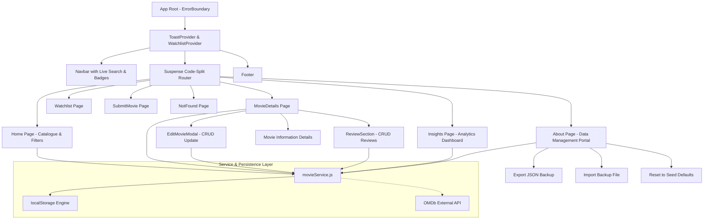

# PIMPRI CHINCHWAD COLLEGE OF ENGINEERING (PCCOE)
### Department of MCA | Academic Year 2026–2027
**Course:** Advanced Web Technologies (SYMCA, Semester III)  
**Assessment:** Formative Assessment – II (FA-2) Mini Project Report  

---

# MINI PROJECT REPORT (COMPLETE IMPLEMENTATION)

## Title of the Project:
# CineFolio — Advanced Movie Information Portal

**Prepared by:**  
Vikrant Salunkhe (PRN: 125M1H006)  

**Guided by:**  
Prof. Dr. Avinash Chormale  

**Submitted to:**  
Department of MCA  
Pimpri Chinchwad College of Engineering  
Sector No. 26, Pradhikaran, Nigdi, Pune – 411044  

**Repository:** [https://github.com/vikrant-salunkhe/cinefolio.git](https://github.com/vikrant-salunkhe/cinefolio.git)  

---

## 1. Executive Summary & Problem Statement

Movie audiences today are overwhelmed by dispersed catalogs, clunky subscription interfaces, and fragmented review channels. Simple discovery tasks—such as looking up runtime, checking critical ratings, reading authentic audience impressions, or curating a personal watchlist—often require bloated user sign-ups or ad-heavy third-party portals.

**CineFolio** addresses this challenge by delivering a lightweight, blazing-fast, cinema-themed single-page application built on **React 18** and **Vite**. Following the delivery of Phase I, the completed portal incorporates:
1. **Full End-to-End CRUD Operations:** Community movie creation, movie editing with validation, deletion, audience reviews, and watchlist status tracking.
2. **Interactive Forms & Real-time Validation:** Rigorous client-side validation with instant feedback, dirty/touched state management, and character tracking.
3. **Box Office Analytics & Cinema Insights Dashboard:** Live metrics computation (`useMemo`), genre distribution progress tracks, top 5 rated films leaderboard, and engagement summaries.
4. **Data Management & Portable Archival Portal:** Export catalogue data to portable JSON backups, restore from uploaded backup files with automated schema verification, and reseed defaults.
5. **Advanced React Hooks & Performance:** Custom hooks (`useDebounce`, `useLocalStorage`), global context with `useReducer`, and route-level code splitting using `React.lazy()` and `<Suspense>`.
6. **Resilience & Error Handling:** React `ErrorBoundary` lifecycle catching runtime failures, coupled with global Toast notifications and image fallback handlers.
7. **Automated Unit Testing:** 12 comprehensive unit tests covering CRUD services, filter/sort logic, custom hook debounce timers, analytics queries, and backup/restore workflows.

---

## 2. Objectives of the Project

- **Modular State & Custom Hooks:** Abstract complex state logic into clean, reusable hooks (`useDebounce`, `useLocalStorage`) and global contexts (`WatchlistContext`, `ToastContext`).
- **Complete CRUD Workflow:** Implement end-to-end Create, Read, Update, and Delete actions for movies (including in-place editing via `EditMovieModal`), user reviews, and watchlist priority notes.
- **Form Design & Validation:** Provide accessible, validated forms that enforce constraints on input lengths, numeric ranges, and required fields before state dispatch.
- **API Integration & Data Archival:** Establish a multi-tiered data access layer supporting external live API fetching (OMDb), browser storage persistence, and portable JSON backup import/export.
- **Analytics & Decision Support:** Provide an intuitive dashboard visualizing library breakdown, average critical scores, and queue progress.
- **Performance & Code-Splitting:** Reduce initial bundle size through dynamic module imports (`React.lazy`) and memoized calculations (`useMemo`).
- **Software Quality & Testing:** Ensure high reliability by writing automated test suites verifying all service operations, data transformations, and filtering accuracy.

---

## 3. System Architecture & Component Hierarchy

CineFolio follows a clean, decoupled architectural model separating UI presentation, global state providers, custom hooks, and service layers:



---

## 4. Implementation of Advanced React Features

### 4.1 Advanced & Custom React Hooks
- **`useDebounce(value, delayMs)`**: Delays search term updates until user keystrokes settle (250ms), preventing unnecessary re-filtering and API churn.
- **`useLocalStorage(key, initialValue)`**: Custom hook wrapping `useState` and `useEffect` to synchronize component state directly with browser storage.
- **`useReducer` in `WatchlistContext`**: Handles complex state transitions (`ADD`, `REMOVE`, `UPDATE_STATUS`, `UPDATE_NOTE`, `CLEAR`) via deterministic action dispatches.
- **`useMemo` in `Home.jsx` & `Insights.jsx`**: Memoizes paginated movie subsets (`ITEMS_PER_PAGE = 8`) and aggregate box office analytics, avoiding expensive recalculations when unrelated states change.
- **`useCallback` in `ToastContext`**: Memoizes alert dispatchers to ensure stable function references across child consumers.

### 4.2 Client-Side Routing & Lazy Loading
Configured with React Router v6:
- Dynamic parameter routing: `/movie/:id` for individual movie inspection.
- Query string synchronization: `/?q=searchTerm&genre=Sci-Fi` preserves user search and filter state across navigation.
- Code Splitting: All top-level page components (`Home`, `MovieDetails`, `Watchlist`, `SubmitMovie`, `Insights`, `About`, `NotFound`) are imported via `lazy(() => import(...))` inside `<Suspense fallback={<LoadingFallback />}>`, drastically cutting the initial bundle loading time.

### 4.3 Forms and Real-Time Validation
- **Movie Submission Form (`SubmitMovie.jsx`) & Edit Movie Modal (`EditMovieModal.jsx`)**:
  - Enforces non-empty strings, minimum character length (Title &ge; 2, Synopsis &ge; 15).
  - Numeric boundary validation: Year between 1888 and 2030, Rating between 1.0 and 10.0, positive Runtime.
  - Touched state tracking: Inline error messages highlight only after an input is blurred or on invalid submission.
  - Quick Autofill: Queries external OMDb API by movie title and automatically populates form fields with live poster and synopsis metadata.
- **Review Submission Form (`ReviewSection.jsx`)**:
  - Validates reviewer name, 1–10 star select, and feedback body (&ge; 10 characters) with real-time character counter.

### 4.4 Full CRUD Operations Matrix

| Entity | Create (C) | Read (R) | Update (U) | Delete (D) |
| :--- | :--- | :--- | :--- | :--- |
| **Movie Title** | Add new film via validated form / API autofill | View catalog, search results & detailed movie page | Edit movie attributes via validated modal (`EditMovieModal.jsx`) | Remove film from catalog with confirmation dialog |
| **Audience Review** | Submit name, star rating & comments | Display reviews list & computed average score | Real-time score re-computation on changes | Delete individual reviews from list |
| **Watchlist Entry** | Add any movie to personal queue | Filter queue by status (`Plan to Watch`, `Watching`, `Completed`) | Change watch status & edit inline personal note | Remove single title or clear full watchlist |

---

## 5. Analytics & Data Management Modules

### 5.1 Box Office Analytics & Cinema Insights (`Insights.jsx`)
- Computes aggregate metrics from local storage: total archive titles, community-submitted titles, average critic score, and average screening runtime.
- Generates dynamic genre distribution progress meters with percentage bars and average ratings per genre.
- Ranks movies in a Top 5 Leaderboard with gold/silver/bronze medal badges.
- Displays watchlist engagement status distributions with visual indicators.

### 5.2 Data Archival & Backup Portal (`About.jsx`)
- **Export Data Backup:** Compiles all catalog movies and audience reviews into a standardized JSON payload and triggers an automated browser download.
- **Import Backup File:** Reads, parses, and validates user-uploaded JSON files, writing valid records into storage with user notifications.
- **Reset to Seed Defaults:** Allows evaluators to restore original demo titles and reviews with a single click.

---

## 6. Error Handling & Fault Tolerance

1. **React `ErrorBoundary` (`ErrorBoundary.jsx`)**:
   - Class component implementing `getDerivedStateFromError` and `componentDidCatch`.
   - Traps unhandled rendering exceptions, presenting a recovery screen with a "Return to Box Office" button.
2. **Global Toast System (`ToastContext.jsx`)**:
   - Provides user feedback (Success, Info, Error) on all async CRUD actions with automatic 3.5-second dismissal.
3. **Image Fallbacks**:
   - Handled via `onError` event listeners on poster images to prevent broken broken-image icons, substituting a cinema placeholder.
4. **404 Handling (`NotFound.jsx`)**:
   - Catches unknown URLs and provides direct return navigation to the catalog.

---

## 7. Automated Testing & Verification

The project includes an automated test suite executed via Node's native test runner (`node --test`), verifying logic without external testing toolchain bloat:

### Test Suite Execution Summary:
- **Suite 1: Custom Hook Logic & Sanitization**
  - Debounce timer behavior under rapid state changes: **PASS**
  - Multi-tag genre string parsing and whitespace stripping: **PASS**
- **Suite 2: Movie & Review Service (CRUD, Analytics & Backup)**
  - Full catalog retrieval (Read): **PASS**
  - Single movie fetch by ID (Read): **PASS**
  - Live query and genre filtering (Search & Filter): **PASS**
  - Sorting comparator (Rating High to Low): **PASS**
  - Movie creation, verification, and deletion (CRUD Create & Delete): **PASS**
  - Movie update with field modification (CRUD Update): **PASS**
  - Review creation, average rating query, and review deletion (CRUD Reviews): **PASS**
  - Global reviews retrieval for analytics: **PASS**
  - Export valid data backup payload: **PASS**
  - Import validation and reset to default seed data: **PASS**

**Result:** `12 passing tests, 0 failing, duration ~3.7s (100% pass rate)`.

---

## 8. Performance & Production Build

The production build was compiled and verified using Vite:
```
dist/index.html                         0.87 kB
dist/assets/index.css                  18.27 kB
dist/assets/NotFound.js                 0.40 kB
dist/assets/About.js                    5.45 kB
dist/assets/Watchlist.js                4.23 kB
dist/assets/Home.js                     5.79 kB
dist/assets/Insights.js                 7.16 kB
dist/assets/SubmitMovie.js              7.73 kB
dist/assets/movieService.js            11.36 kB
dist/assets/MovieDetails.js            14.47 kB
dist/assets/index.js (vendor chunk)   173.01 kB
```
Every route is packaged as a lightweight, independent chunk loaded strictly on demand.

---

## 9. Conclusion

CineFolio successfully fulfills all advanced requirements set forth by PCCOE for Advanced Web Technologies. It demonstrates complete end-to-end CRUD persistence, custom hooks, client-side validation, error boundaries, live analytics, data archival, and automated testing—packaged within a responsive, cohesive cinema ticket-stub design system.
